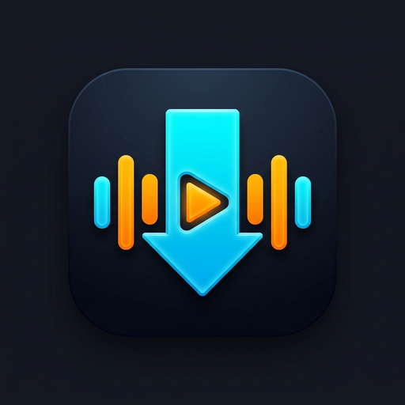

# AccessGrab

<p align="center">
  
</p>

<p align="center">
  <strong>Android için %100 Ekran Okuyucu ve Erişilebilirlik Odaklı Medya Yöneticisi</strong>
</p>

<p align="center">
  
  
  
  
  
  
</p>

---

## 🌟 Proje Hakkında

**AccessGrab**, dijital içeriklere erişimde karşılaşılan engelleri ortadan kaldırmak amacıyla geliştirilmiş, **açık kaynak kodlu ve özgür** bir Android uygulamasıdır. Günümüzdeki birçok indirme aracının karmaşık, reklam dolu ve ekran okuyucular tarafından okunamaz arayüzlerine karşın; **AccessGrab** tamamen görme engelli bireyler, ekran okuyucu (**TalkBack**) kullanıcıları ve sade bir deneyim arayanlar için tasarlanmıştır.

Uygulama; medya indirme süreçlerini, canlı ilerleme durumlarını ve dosya yönetimini sesli ve anlaşılır geri bildirimlerle kullanıcıya aktarır.

---

## 🛠️ Teknik Mimari ve Mühendislik Detayları

AccessGrab, Google'ın modern Android geliştirme standartlarına (Modern Android Development - MAD) tam uyumlu olarak inşa edilmiştir:

### 1. Mimari Tasarım Deseni (MVVM & UDF)
- **Model-View-ViewModel (MVVM):** İş mantığı ile UI katmanı kesin çizgilerle birbirinden ayrılmıştır.
- **Unidirectional Data Flow (UDF):** Kullanıcı etkileşimleri ViewModel'e olay (Event) olarak iletilir; UI durumu ise reaktif bir akışla (`StateFlow`) tek yönde ekrana beslenir. Bu sayede ekran döndürme ve arka plan geçişlerinde durum kaybı yaşanmaz.

### 2. Modern UI & Tasarım Sistemi
- **Jetpack Compose:** Tamamen bildirimsel (declarative) Compose bileşenleri ile yazılmıştır; klasik XML görünüm hiyerarşisi kullanılmamıştır.
- **Material Design 3 (Material You):** Yüksek kontrastlı tema desteği, dinamik tipografi ve dokunma hedefleri ile hem estetik hem de ergonomik bir görsel deneyim sunar.
- **Canlı Durum Göstergeleri:** İndirme esnasında hem lineer ilerleme çubuğu hem de dinamik yüzdelik (`%45`) ve megabayt (`12.4 MB / 28.5 MB`) göstergeleri UI üzerinde eşzamanlı güncellenir.

### 3. Asenkron Akış ve İş Parçacığı Yönetimi
- **Kotlin Coroutines:** Uzun süren I/O ve ağ işlemleri UI (Main) iş parçacığını bloke etmeden `Dispatchers.IO` üzerinde optimize şekilde yürütülür.
- **StateFlow & SharedFlow:** Reaktif veri akışları kullanılarak indirme yüzdeleri ve durum mesajları anlık olarak arayüze taşınır.

### 4. İndirme Motoru ve Sistem Entegrasyonu
- **Android `DownloadManager` API:** Cihazın yerel indirme motoru ile tam entegredir. Uygulama arka plana atılsa veya ekran kilitlense bile indirmeler sistem seviyesinde kesintisiz devam eder.
- **Sistem İlerleme Takibi (Querying):** Arka planda çalışan periyodik sorgulayıcı, indirilen baytları ve toplam dosya boyutunu milisaniyelik hassasiyetle hesaplar.
- **`BroadcastReceiver` Desteği:** İndirme tamamlandığında sistem yayını yakalanır, dosya cihazın yerel `İndirilenler` dizinine kaydedilir ve kullanıcıya anında geri bildirim sağlanır.

### 5. Derinlemesine Erişilebilirlik Mühendisliği (A11y)
- **Gelişmiş Semantik (Semantics API):** Tüm butonlar, simgeler ve metin alanları TalkBack için özel olarak etiketlenmiştir.
- **Canlı İlerleme Seslendirmesi (`liveRegion`):** İndirme esnasında değişen yüzdeler ve durum bildirimleri ekran okuyucu tarafından periyodik ve akıcı şekilde seslendirilir.
- **Ergonomik Dokunma Hedefleri:** Tüm etkileşimli alanlar en az `48x48 dp` dokunma alanına sahiptir; böylece motor beceri kısıtı bulunan kullanıcılar da kolayca erişebilir.
- **Focus Yönetimi:** Ekranlar arası geçişte veya hata durumlarında ekran okuyucu odağı otomatik olarak ilgili durum mesajına taşınır.

### 6. Güvenlik, Dosya Sağlayıcı ve Paketleme
- **Android `FileProvider`:** Android 7.0+ ve Android 14+ sürümlerinde güvenli dosya paylaşımı ve uygulama güncellemesi için `content://` URI standartları uygulanmıştır.
- **Çift Katmanlı APK İmzalama (v1 + v2 Scheme):** Uygulama hem eski hem yeni nesil Android cihazlarda kurcalanmaya karşı tam koruma sağlayan `APK Signature Scheme v1 ve v2` ile imzalanmıştır.
- **Dahili Güncelleme Mekanizması:** Uygulama içinden sürüm kontrolü yapılarak doğrudan `PackageInstaller` aracılığıyla güvenli kurulum tetiklenir.

---

## 🔨 Kaynak Koddan Derleme (Build from Source)

Projeyi kendi bilgisayarınızda derlemek için:

1. Bu depoyu klonlayın:
   ```bash
   git clone https://github.com/bawer-elci/AccessGrab.git
   cd AccessGrab
   ```
2. Android Studio (Ladybug / Iguana veya üstü) ile projeyi açın veya komut satırından derleyin:
   ```bash
   # Debug APK derleme:
   ./gradlew assembleDebug

   # Release APK derleme:
   ./gradlew assembleRelease
   ```
3. Derlenen `.apk` dosyası `app/build/outputs/apk/` klasöründe oluşacaktır.

---

## 📥 Hazır APK İndirme

Uygulamayı doğrudan cihazınıza kurup denemek için:

👉 **[AccessGrab v1.5.1 APK İndir](https://github.com/bawer-elci/AccessGrab/releases/download/v1.5.1/AccessGrab.apk)**

---

## 📜 Lisans (License)

Bu proje **GNU General Public License v3.0 (GPLv3)** lisansı altında lisanslanmıştır. 

* Projeyi özgürce inceleyebilir, değiştirebilir ve geliştirebilirsiniz.
* Bu projeyi temel alan veya kullanan tüm türev çalışmalar da **GPLv3 lisansı ile açık kaynak kalmak zorundadır**.
* Detaylar için [LICENSE](LICENSE) dosyasına göz atabilirsiniz.

---

## ⭐ Projeye Destek Olun

Eğer bu proje işinize yaradıysa ve erişilebilir açık kaynak yazılım hareketine destek olmak isterseniz, sayfanın sağ üst köşesindeki **⭐ Star (Yıldız)** butonuna basarak projeyi öne çıkarabilirsiniz!

---

## 👨‍💻 Geliştirici

- **Geliştirici:** [Baver Elçi](https://github.com/bawer-elci)
- **GitHub:** [@bawer-elci](https://github.com/bawer-elci)
- **Web Sitesi:** [baverelci.com.tr](https://baverelci.com.tr)
- **E-Posta:** bawerelci7221@gmail.com
